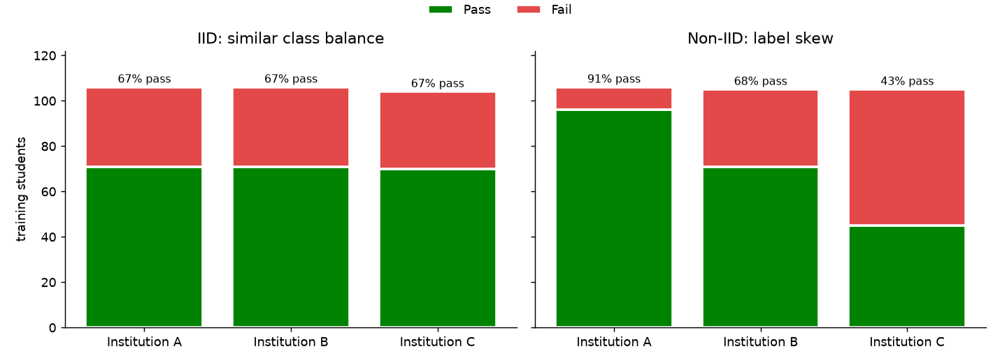
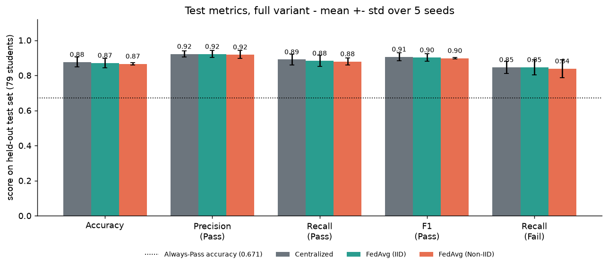
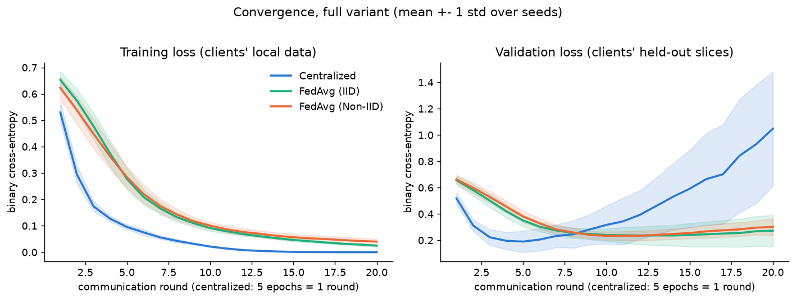

# Federated Learning for Educational Analytics

A final-year B.Tech (CSE) project that builds and evaluates a **simulated federated learning (FL) system** for
predicting student Pass/Fail outcomes. Three simulated educational institutions train the same neural network on
their own student records; a central server combines the models with **Federated Averaging (FedAvg)** so that raw
student data never leaves the institution.

> **Honesty note.** This is a controlled simulation on the public UCI Student Performance dataset. No real college
> or institutional system is connected, and plain FedAvg does not provide formal privacy guarantees (see
> [Limitations](#limitations)). Every number in this README is read from files generated by the pipeline.

---

## Table of contents

1. [Abstract](#abstract)
2. [Problem statement and motivation](#problem-statement-and-motivation)
3. [Objectives](#objectives)
4. [Existing vs proposed system](#existing-vs-proposed-system)
5. [Background and references](#background-and-references)
6. [Dataset](#dataset)
7. [Methodology](#methodology)
8. [System architecture](#system-architecture)
9. [Federated learning workflow and FedAvg](#federated-learning-workflow-and-fedavg)
10. [IID vs Non-IID clients](#iid-vs-non-iid-clients)
11. [Model architecture](#model-architecture)
12. [Experimental configuration](#experimental-configuration)
13. [Results](#results)
14. [Dashboard](#dashboard)
15. [Installation](#installation)
16. [How to run](#how-to-run)
17. [Project structure](#project-structure)
18. [Testing](#testing)
19. [Limitations](#limitations)
20. [Future scope](#future-scope)

---

## Abstract

Educational institutions hold valuable student data, and predictive models benefit from more data, but privacy law
and governance usually forbid pooling student records centrally. Federated learning trains a shared model where the
data live: each participant trains locally and only model parameters are exchanged. This project implements a
transparent FedAvg simulation with three clients on the UCI Student Performance (mathematics) dataset, compares it
with a centralized baseline on an identical held-out test set, and studies the effect of statistically heterogeneous
(Non-IID) client data. Over five random seeds, the federated models reach test accuracy of 0.871 ± 0.027 (IID) and
0.866 ± 0.006 (Non-IID) against 0.876 ± 0.028 for centralized training, i.e. no meaningful loss from keeping data
local. An early-prediction variant without the mid-year grades G1 and G2 performs no better than always predicting
"Pass" and is reported as a negative result. The system includes a leakage-safe preprocessing pipeline, a
schema-driven prediction tool, an eight-page Streamlit dashboard, and 62 automated tests.

## Problem statement and motivation

- Student records contain sensitive demographic, family and academic information.
- A single institution has few records (here, a few hundred), which limits model quality.
- Centralising data across institutions raises legal, ethical and governance barriers.
- **Question:** can institutions obtain a jointly trained predictive model *without* sharing raw records, and how
  much accuracy (if any) does this cost, especially when institutions' student populations differ?

## Objectives

1. Build a reproducible FL simulation: 3 clients, local training, FedAvg aggregation, 20 communication rounds.
2. Guarantee that no raw student record is transmitted to the server (enforced in code and tests).
3. Compare centralized training vs FedAvg with IID clients vs FedAvg with Non-IID clients on one fixed test set.
4. Prevent target leakage (G3 is never an input) and preprocessing leakage (fit on training rows only).
5. Provide an interactive dashboard and a validated student prediction tool.
6. Document methods, results, limitations and viva material honestly.

## Existing vs proposed system

| | Existing (centralized analytics) | Proposed (federated analytics) |
|---|---|---|
| Where data live | Copied to a central database | Stay at each institution |
| What is transmitted | Raw student rows | Model weights (2,433 numbers), sample count, 2 loss values |
| Model | Trained once on pooled data | Global model = sample-weighted average of local models, repeated for 20 rounds |
| Governance | Requires data-sharing agreements for raw data | Requires agreement only on model exchange |
| Heterogeneity | Not an issue (pooled) | Must be handled: client distributions differ (Non-IID) |

## Background and references

Federated learning and FedAvg were introduced by McMahan et al. (2017). Zhao et al. (2018) showed that Non-IID
client data degrades FedAvg. Kairouz et al. (2021) survey the field, including privacy attacks and defences.
Bonawitz et al. (2017) proposed secure aggregation and McMahan et al. (2018) differentially private FedAvg. The
dataset and the original prediction study are from Cortez and Silva (2008). Full references are listed in
[`docs/PROJECT_REPORT.md`](docs/PROJECT_REPORT.md#references); verify each against the original source before citing.

## Dataset

**UCI Student Performance, mathematics course (`student-mat.csv`)**
Source: <https://archive.ics.uci.edu/dataset/320/student+performance>. The file is included at
`data/raw/student-mat.csv` under the dataset's **CC BY 4.0** licence, which permits sharing with attribution.
Attribution: Cortez, P. (2008). Student Performance [Dataset]. UCI Machine Learning Repository.
<https://doi.org/10.24432/C5TG7T>

| Property | Value (computed by `python main.py verify`) |
|---|---|
| Rows | 395 students |
| Columns | 33 (17 categorical, 13 numeric, 3 grades G1 G2 G3) |
| Separator | `;` |
| Missing values | 0 |
| Target | `pass = (G3 >= 10)` → 265 Pass / 130 Fail (67.1 % pass) |
| Split | Stratified 80/20, seed 42 → 316 train / 79 test (53 Pass / 26 Fail) |

G1 and G2 are first- and second-period grades in the same course, G3 the final grade (all 0-20). **G3 is only used
to construct the label.** Because G1/G2 are very strong predictors of G3 (r ≈ 0.80 and 0.90), two feature variants
are evaluated:

- **full** – uses G1 and G2 (58 features after one-hot encoding). Predicts the *final* outcome once mid-year grades
  exist.
- **early** – drops G1 and G2 (56 features). Tests what is predictable at the start of the year.

The exploratory analysis is in [`notebooks/01_exploratory_data_analysis.ipynb`](notebooks/01_exploratory_data_analysis.ipynb).

## Methodology

1. **Verify** the raw file (shape, columns, missing values).
2. **Split first**, stratified by the label, before anything is fitted.
3. **Preprocess**: one-hot encode categoricals, standard-scale numerics, both **fit on training rows only**; save
   the fitted preprocessor and a `schema.json` describing every input (type, categories, ranges).
4. **Partition** the 316 training rows into 3 clients, IID or Non-IID, deterministically; every row used exactly once.
5. **Train** three ways with the same model and the same total number of passes over the data:
   centralized (100 epochs), FedAvg IID and FedAvg Non-IID (20 rounds × 5 local epochs).
6. **Evaluate** on the untouched 79-student test set; repeat for 5 seeds; report mean ± std.
7. **Serve** the seed-42 models through a predictor that validates inputs against the schema and applies the exact
   same preprocessor.

## System architecture

```
┌────────────────────────── Aggregation server ──────────────────────────┐
│  global model  ←  FedAvg:  w = Σ_k (n_k / N) · w_k                     │
└──────────▲──────────────────────▲──────────────────────▲───────────────┘
           │ weights, n_k         │ weights, n_k         │ weights, n_k      (uplink, solid)
           │ ◄─ global model      │ ◄─ global model      │ ◄─ global model   (downlink, dashed)
┌──────────┴─────────┐ ┌──────────┴─────────┐ ┌──────────┴─────────┐
│  Institution A     │ │  Institution B     │ │  Institution C     │
│  private records   │ │  private records   │ │  private records   │
│  local model       │ │  local model       │ │  local model       │
└────────────────────┘ └────────────────────┘ └────────────────────┘
```

Code map: clients in `src/clients/`, aggregation rule in `src/strategies/fedavg.py`, round loop in
`src/server/server.py`, shared model in `src/models/`, pipeline stages in `src/experiments/`.

## Federated learning workflow and FedAvg

One communication round:

1. Server broadcasts the current global weights.
2. Each client trains locally for 5 epochs (Adam, lr 0.001, batch 16) on its own students.
3. Each client returns a `ClientUpdate`: weights, number of training samples `n_k`, train loss, validation loss.
4. Server aggregates with FedAvg; the result is the new global model.
5. Repeat for 20 rounds; evaluate the final global model on the test set.

**FedAvg** (McMahan et al., 2017):

$$ w_{\text{global}} = \sum_{k=1}^{K} \frac{n_k}{N} \, w_k, \qquad N = \sum_{k=1}^{K} n_k $$

Example with two clients and one weight: A has 100 samples and weight 0.8, B has 300 samples and weight 0.4.
N = 400, so w = 0.25·0.8 + 0.75·0.4 = **0.5**. Implemented as a pure function in `src/strategies/fedavg.py` and unit
tested against hand-computed values.

**Why a custom implementation instead of Flower (flwr)?** Flower's simulation engine depends on Ray, which is heavy
and fragile on Windows, and it hides aggregation inside a strategy class. For a project whose purpose is to understand
and defend FedAvg, an explicit, fully tested implementation is clearer. The algorithm is identical; only the transport
(here, an in-process function call) differs.

## IID vs Non-IID clients

Partitions are over the 316 training rows only (seed 42):

| Scheme | Institution A | Institution B | Institution C |
|---|---|---|---|
| IID | 106 students, 67 % pass | 106 students, 67 % pass | 104 students, 67 % pass |
| Non-IID (label skew) | 106 students, **91 %** pass | 105 students, 68 % pass | 105 students, **43 %** pass |

IID = every client sees the same distribution. Non-IID = deliberately different Pass rates, modelling the reality
that a selective school and a struggling school have different outcome distributions (statistical heterogeneity).



## Model architecture

Identical on every client and in the centralized baseline (`src/models/mlp.py`):

| Layer | Shape (full variant) | Activation | Parameters |
|---|---|---|---|
| Input | 58 features | – | – |
| Hidden 1 | 58 → 32 | ReLU | 1,888 |
| Hidden 2 | 32 → 16 | ReLU | 528 |
| Output | 16 → 1 logit | sigmoid at inference | 17 |
| **Total** | | | **2,433** (9.7 KB in float32) |

Loss: `BCEWithLogitsLoss` (numerically stable sigmoid + binary cross-entropy). Optimiser: Adam, learning rate 0.001.
Batch size 16. Identical architecture is what makes weight averaging valid.

## Experimental configuration

| Setting | Value |
|---|---|
| Clients | 3 |
| Rounds × local epochs | 20 × 5 (centralized: 100 epochs) |
| Seeds | 42, 43, 44, 45, 46 (partition fixed at seed 42; seed changes init and batch order) |
| Local validation | each client holds out 20 % of its rows for loss monitoring only |
| Test set | same 79 students for every method and seed; never used for any decision |
| Hardware | CPU only; a full 5-seed run takes about 2-3 minutes |

Everything is recorded in `results/reports/experiment_config.json`.

## Results

Mean ± std over 5 seeds on the held-out test set (`results/reports/metrics_table.md`). Precision/recall/F1 are for the
Pass class; "Recall (Fail)" is the share of failing students correctly identified.

**Full variant (with G1, G2)**

| Method | Accuracy | Precision | Recall | F1 | Recall (Fail) | ROC AUC | Comm. |
|---|---|---|---|---|---|---|---|
| Always-Pass baseline | 0.671 | – | – | 0.803 | 0.000 | – | – |
| Centralized | 0.876 ± 0.028 | 0.922 ± 0.018 | 0.891 ± 0.030 | 0.906 ± 0.022 | 0.846 ± 0.034 | 0.925 ± 0.012 | 0 |
| FedAvg (IID) | 0.871 ± 0.027 | 0.922 ± 0.020 | 0.883 ± 0.032 | 0.902 ± 0.022 | 0.846 ± 0.042 | 0.937 ± 0.018 | 1.17 MB |
| FedAvg (Non-IID) | 0.866 ± 0.006 | 0.918 ± 0.023 | 0.879 ± 0.019 | 0.898 ± 0.004 | 0.838 ± 0.051 | 0.941 ± 0.005 | 1.17 MB |

**Early variant (without G1, G2)**

| Method | Accuracy | Precision | Recall | F1 | Recall (Fail) | ROC AUC |
|---|---|---|---|---|---|---|
| Always-Pass baseline | 0.671 | – | – | 0.803 | 0.000 | – |
| Centralized | 0.656 ± 0.012 | 0.720 ± 0.009 | 0.796 ± 0.028 | 0.756 ± 0.012 | 0.369 ± 0.039 | 0.558 ± 0.026 |
| FedAvg (IID) | 0.671 ± 0.023 | 0.729 ± 0.014 | 0.811 ± 0.034 | 0.768 ± 0.019 | 0.385 ± 0.042 | 0.585 ± 0.026 |
| FedAvg (Non-IID) | 0.676 ± 0.015 | 0.716 ± 0.013 | 0.857 ± 0.009 | 0.780 ± 0.009 | 0.308 ± 0.042 | 0.651 ± 0.013 |




**Findings**

- **FL matches centralized training.** The 1.0-point accuracy gap between the best and worst full-variant method is
  smaller than the seed-to-seed standard deviation (up to 0.028): the three are statistically indistinguishable here.
- **Non-IID did not break FedAvg** at this scale, but the per-client validation curves
  (`results/figures/client_val_loss_full.png`) show the global model fits the 43 %-pass institution worst: a single
  averaged model is a compromise between differing populations.
- **Over-fitting without early stopping.** Centralized validation loss is lowest around round 5 and rises steeply
  afterwards; FedAvg's is lowest around round 10-11 and rises only slightly. Test metrics are from the final round
  regardless, to keep the comparison fair.
- **The early variant is not usable.** Without G1/G2 every method is at or below the 67.1 % always-Pass accuracy and
  finds only 31-39 % of failing students. The useful model is a *final-outcome* model, not an early-warning one.
- **Communication**: 9.7 KB per model message, 1.17 MB over 20 rounds; more than the ~45 KB raw training CSV. On a
  dataset this small FL's benefit is governance, not bandwidth.
- **Statistical caution**: one test student = 1.3 accuracy points. Differences below ~3 points are noise.

Seed-42 confusion matrices (rows true Fail/Pass, columns predicted Fail/Pass): Centralized [[21, 5], [7, 46]],
FedAvg IID [[22, 4], [9, 44]], FedAvg Non-IID [[22, 4], [6, 47]].

## Dashboard

Eight Streamlit pages, every figure generated from pipeline artifacts:

1. **Overview** – problem, objectives, key metrics, system picture
2. **Dataset Analytics** – distributions, per-feature pass rates, correlations, attribute dictionary
3. **Federated Architecture** – SVG architecture, round walkthrough, FedAvg formula and example
4. **Client Data Distribution** – IID vs Non-IID partitions
5. **Training & Convergence** – loss curves with seed bands, client-level curves, round table, communication cost
6. **Model Evaluation** – metrics table and chart, confusion matrices, per-class and per-seed tables, interpretation
7. **Student Prediction** – form generated from the training schema, probabilities, what-if sensitivity
8. **Privacy & Limitations** – what is and is not transmitted, what FedAvg does not guarantee, future work

Screenshots: see [`docs/screenshots/`](docs/screenshots/README.md).

## Installation

Requirements: Windows 10/11 (also works on Linux/macOS), Python 3.11 or newer, about 2 GB disk for PyTorch.

```powershell
git clone https://github.com/SushmithaB-06/federated-learning-educational-analytics.git
cd federated-learning-educational-analytics
python -m venv .venv
.\.venv\Scripts\Activate.ps1
python -m pip install --upgrade pip
pip install -r requirements.txt
```

The dataset is already in the repository, so nothing else is needed.

## How to run

```powershell
python main.py verify        # dataset check
python main.py prepare       # split + preprocess, saves preprocessor and schema
python main.py partition     # IID / Non-IID client partitions
python main.py experiments   # centralized + FedAvg runs, 5 seeds (2-3 min on CPU)
python main.py figures       # tables and figures
python main.py all           # all of the above in order
python -m pytest             # 62 tests
python main.py dashboard     # or: streamlit run dashboard/app.py
```

Each stage is also a module: `python -m src.experiments.run_experiments --quick` runs a single seed.

## Project structure

```
├── main.py                      pipeline entry point
├── requirements.txt
├── data/raw/                    student-mat.csv (CC BY 4.0, committed)
├── data/processed/              regenerated arrays (not committed)
├── notebooks/01_exploratory_data_analysis.ipynb
├── src/
│   ├── config.py                paths, constants, hyper-parameters (single source of truth)
│   ├── data/   load.py, preprocess.py
│   ├── clients/ partition.py, client.py
│   ├── models/  mlp.py, train.py, io.py
│   ├── strategies/fedavg.py
│   ├── server/server.py
│   ├── evaluation/ metrics.py, make_figures.py, palette.py
│   ├── experiments/ prepare_data.py, make_partitions.py, run_experiments.py
│   └── utils/ seed.py, predictor.py
├── dashboard/ app.py, common.py, views/<8 pages>.py
├── results/
│   ├── models/{full,early}/     preprocessor, schema, seed-42 models (small, committed)
│   ├── reports/                 dataset_summary, partitions, runs/*.json, experiment_summary, metrics_table
│   └── figures/                 all PNG figures
├── tests/                       62 pytest tests
└── docs/                        PROJECT_REPORT.md, VIVA_GUIDE.md, DEPLOYMENT.md, screenshots/
```

Model artifacts are committed because they are tiny (< 20 KB each) and let the dashboard run on a fresh clone;
processed arrays are not, and are regenerated by the pipeline.

## Testing

`python -m pytest` runs 62 tests: dataset loading, target construction, leakage (G3 absent, scaler fit on train only,
single-row transform equals stored row), partition coverage and determinism, FedAvg against hand-computed values,
model dimensions and parameter count, model save/load, client update contents, a source scan that the server never
touches client data, metric formulas, predictor validation and consistency, and every dashboard page via Streamlit's
`AppTest`. A seed-42 re-run was verified to reproduce all result files and model weights bit-for-bit.

## Limitations

- **Simulation only.** Three partitions of one public dataset; no real institution, no network transport.
- **Small data.** 395 students, 79 in the test set; differences of a few points are within noise.
- **FedAvg is not a privacy guarantee.** Updates can leak information (gradient inversion, membership inference), the
  server sees each client's weights, and no differential privacy or secure aggregation is implemented.
- **Early prediction failed.** Without G1/G2 the model is no better than the always-Pass baseline.
- **No early stopping**; fixed 20-round budget.
- **Label skew only**; feature skew, quantity skew and more clients were not studied.
- **One country, two schools, one year.**

## Future scope

Differential privacy (clipped, noised updates), secure aggregation, early stopping on client validation loss,
FedProx/SCAFFOLD under stronger heterogeneity, the 649-student Portuguese-course file as a second dataset, more
clients with unequal sizes, and real transport via Flower once the method is settled. An experimental five-class
grade-band model (A 16-20, B 14-15, C 12-13, D 10-11, F 0-9) is defined in `src/config.py` but **has not been trained
or evaluated**.

## Author

Sushmitha B – B.Tech CSE, 2027 batch. Repository: <https://github.com/SushmithaB-06/federated-learning-educational-analytics>
